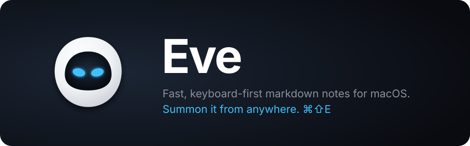
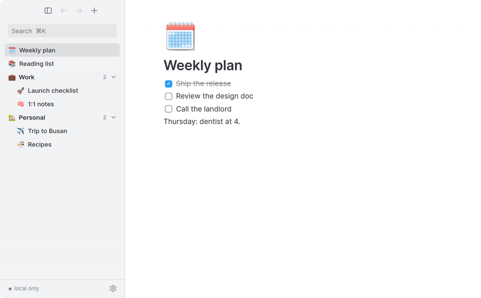
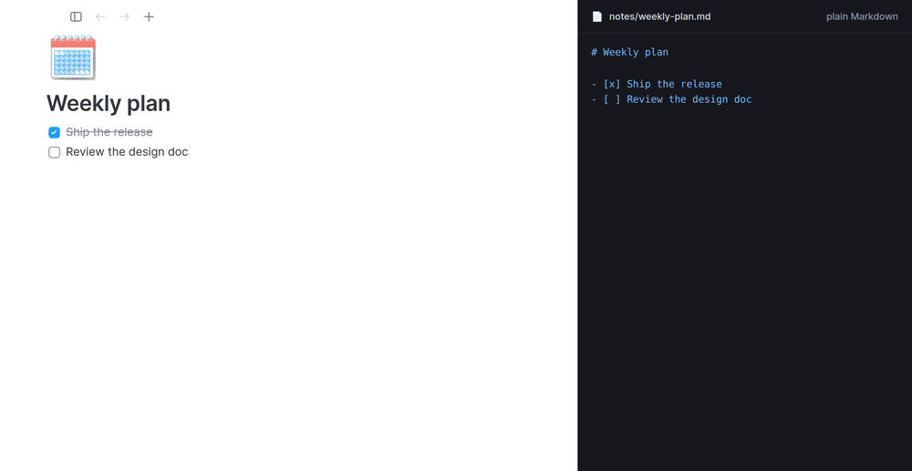

<p align="center"></p>

# Eve

Notion's editor on plain Markdown files you own — up in a keystroke on the Mac, and on your Android phone.

## Why Eve

Every notes app asks you to give something up. Notion writes like a page but keeps your notes on its servers.
Obsidian keeps them as files but has you looking at Markdown. A quick-capture app opens fast but holds only scraps.
Eve gives up none of these:

- **Notion's page, without Notion's servers.** The same editor and the same keys — `/` blocks, toggles, callouts,
  databases, `⌘⌥1` for a heading — but every note is a `.md` file on your disk that Obsidian, GitHub or `grep`
  reads as it is. Leaving Eve means nothing to export.
- **Files, without writing Markdown.** You see headings, to-dos, tables, flowcharts and equations, and edit them
  where they are drawn. The Markdown is underneath for any other tool.
- **Faster than switching to a tab.** `⌘⇧E` from any app, type, `Esc`, and you are back where you were. A native
  app (Tauri and the system's WebKit, an 8 MB download), not Electron.
- **Sync with no one in between.** A private GitHub repository of your own is the server. There is no Eve account
  and no subscription, and git keeps every version. A note written on two devices before they synced is merged
  line by line. Whatever cannot be merged is kept as a copy beside it, never dropped.
- **Claude knows your notes.** One click connects Eve's MCP server. Claude finds, reads and writes notes, and each
  change goes through the app as if you had typed it; a note it deletes goes to the trash.
- **On your phone too.** An Android app with a home-screen widget and background sync, and the same notes.

Not for you if you need an iPhone, Windows or an Intel Mac, or want to edit a page live with other people: Eve is
one person's notes on Apple silicon Macs and Android.

## A look

### 1. Write it down before you forget it

`⌘⇧E` from any app brings Eve up; `⌘N`, type, `Esc` and you are back where you were.
Markdown turns into headings and to-dos as you type, and `⌘P` (or `⌘K`) finds any note in a few letters.

<p align="center"></p>

### 2. Rich pages, no syntax to learn

Type `/` for flowcharts, equations, kanban boards, callouts, code and images.
Each is drawn in the note and edited by clicking on it — no Mermaid or TeX needed.

<p align="center"></p>

### 3. Your notes stay yours

Every note is a plain `.md` file — readable by Obsidian, GitHub, or any editor — synced through a private
GitHub repo with no server in between. Claude can read and write them too, with one click to connect.

<p align="center"></p>

<details>
<summary><b>Everything else</b></summary>

- **Notes link to notes** — `[[` picks one; `[[Note|alias]]`, `==highlight==` and `> [!warning]` callouts as Obsidian writes them.
- **Lists that nest like a document** — `1.` → `a.` → `i.`; bullets, numbers and to-dos mix freely.
- **Sidebar** — groups (3 levels), emoji icons, drag to reorder, `⌘1`…`⌘9` to jump, `⌘\` to drive it from the keyboard.
- **Link cards, pictures, find & replace** (`⌘F`), section outline, text size (`⌘+` `⌘-`).
- **Present a note** — ⋯ → Present: a slide at each divider and each of its biggest headings, the window on the whole
  screen; → walks a diagram that draws itself in a step at a time before it turns the page.
- **Import a folder** — drop an Obsidian vault, a Notion export or Google Keep Takeout on the sidebar.
- **Opens any `.md`** from Finder's *Open With*, edited in place.
- **Every shortcut is rebindable** in Settings (`⌘,`).
- **Command line** — `eve search`, `eve read`, `eve open` from a terminal.
- **Small and fast** — Tauri 2 (native WebKit, an 8 MB download), Svelte 5, TipTap. No Electron.

</details>

Named after EVE from Pixar's *WALL·E*: shell white, soft gray, visor black — and eye blue for what matters.

## Install

```bash
brew install --cask happy-nut/tap/eve
```

Apple silicon only. The app is ad-hoc signed, not notarized; the cask strips the quarantine flag so it opens
without a Gatekeeper detour. New versions arrive in the app, as on the phone: when one is out, the sidebar and
Settings → Version offer **Update**, which downloads the release's zip, checks it against the SHA-256 GitHub lists
for it, puts the new Eve.app in place of the old one and restarts (`brew reinstall --cask happy-nut/tap/eve` does the same by hand;
0.7.12 and older need it once).
Releases are built by `.github/workflows/release.yml` from a `v*` tag; the cask lives in [happy-nut/homebrew-tap](https://github.com/happy-nut/homebrew-tap).

## Run from source

```bash
npm install
npm run app        # tauri dev (needs Rust: https://rustup.rs)
npm run bundle     # builds src-tauri/target/release/bundle/macos/Eve.app (~4 MB); drag it to /Applications
```

`npm run dev` runs the UI alone in a browser (notes go to localStorage) — handy for UI work.

## Android

The same app runs on Android (Tauri's Android target), syncing through the same `eve-notes` repository.
Sign in from Settings → Sync on the phone too.

- **Home-screen widget** — long-press the home screen → Widgets → Eve. It asks what to show: the newest notes,
  or one note pinned and shown whole. Markdown is drawn as in the editor (to-dos, bold, code, links,
  callouts, boards as a column count). Tap a note to open it ready to write, + for a new one, ↻ to sync now;
  long-press → the pencil changes what it shows.
- **Background sync** — every 15 minutes (Android's floor) while Eve is closed, notes changed elsewhere come
  down and the widget redraws. The app pushes when it leaves the screen.
- **Opens where you left off** — the note you had open, not the list.
- **A list made for a thumb** — each row shows the note's title, when it was edited and two lines of it. Swipe a
  row left to delete it; long-press it to pick it up and drag it to another place or group.
- Back goes from a note to the list, and from the list out of the app.

```bash
npm run tauri -- android dev              # on a connected phone or emulator (needs ANDROID_HOME, NDK_HOME)
npm run tauri -- android build --apk      # src-tauri/gen/android/app/build/outputs/apk/
```

The phone has its own version (`src-tauri/tauri.android.conf.json`) and its own releases: an `android-v*` tag
builds only the signed APK (never marked Latest, so Homebrew keeps pointing at the Mac), a `v*` tag only the Mac
app. Installed phones find newer APKs by themselves and update with one tap.

Not on the phone: the global hotkey, Dock/login-item settings, and Quick Look previews. Export (Markdown, PDF,
image) is there, from the note's ⋯ menu: the file goes to the share sheet.

## Default shortcuts

Notion's, wherever Notion has a key for the same thing, and Notion's typing rules: `[] ` a to-do, `- ` `* ` `+ `
bullets, `1. ` `a. ` `i. ` numbers, `# ` … `##### ` headings, `> ` a toggle, `" ` (or `| `) a quote, ```` ``` ```` code,
`---` a divider, `**bold**`, `*italic*`, `` `code` ``, `~strike~`, `==highlight==`; `+` a new page under this one (or
one to link), `[[` a link, `@` a date, `@remind` a reminder, `:` an emoji, `/` a block (`/turn…` changes the line,
`/color` colours it).

**Databases** — `/database` makes a table of the pages under this one (Notion's): properties of their own kinds
(text, number, select, tags, date, checkbox, relation, rollup, formula), sorted or filtered from a column's menu, and
Table, Board (grouped by a select; drag a card to another column), Calendar (by a date; drag a row to another day) and
Gallery views. A relation links pages of another database (or any page), a rollup reads through it (count, sum,
average, min, max, the values, percent checked), a formula is Notion's (`prop("Hours") * prop("Rate")`, `if(…)`,
`dateBetween(…)`). ⌘Z / ⌘⇧Z on the table take back and redo what was done there. Each row is a page, its properties
lines of its frontmatter (`Status: Doing`, `Tags: ["home"]`, `Projects: ["[[Eve]]"]`), as Obsidian writes them;
rollups and formulas are worked out, never written; the table itself is a ```` ```database ```` block of JSON.

**Colours and footnotes** — `/color` (or the chosen words' menu → *Text color…*) colours words in Notion's nine,
written `<span style="color: …">`, each readable in both themes. `/footnote` puts `[^1]` at the caret and its line at
the end, as GitHub and Obsidian write footnotes; a click on the number goes to its line.

**Reminders** — `@remind` and a day (09:00, or the next hour today) is written `@2026-10-26 09:00 ⏰`, which any
other app reads as it is; click the chip to change the time or stop it. It rings on the Mac (Eve keeps running in
the background) and on the phone with Eve closed, once the note has synced there; the notification opens the note.
A done to-do's reminder does not ring.

| Scope  | Action                          | Keys              |
| ------ | ------------------------------- | ----------------- |
| system | Summon / dismiss Eve            | `⌘⇧E`             |
| app    | New (note / group menu) / Search | `⌘N` `⌘P` (`⌘K` with no words chosen) |
| app    | Back / Forward / Next / previous note | `⌘[` `⌘]` `⌃⇧J` `⌃⇧K` |
| app    | The page above / Copy its eve:// link / Dark–light | `⌘⇧U` `⌘L` `⌘⇧L` |
| app    | Sidebar: open + focus / close   | `⌘\`              |
| app    | Delete note / Settings / Hide   | `⌘⇧⌫` `⌘,` `Esc`  |
| app    | Export Markdown / PDF / image   | `⌘⇧M` `⌘⇧P` `⌘⌥P` |
| app    | Larger / smaller / default text | `⌘+` `⌘-` `⌘0`    |
| editor | Bold / Italic / Underline       | `⌘B` `⌘I` `⌘U`    |
| editor | Strike / Code / Link            | `⌘⇧S` `⌘E` `⌘K`   |
| editor | Highlight (`==`)                | `⌘⇧H`             |
| editor | `/` menu / Callout / Image       | `⌘/` `⌘⇧C` `⌘⇧I` |
| editor | Equation in the line (`$`)      | `⌘⌥E`             |
| editor | Text / H1 / H2 / H3             | `⌘⌥0` `⌘⌥1` `⌘⌥2` `⌘⌥3` |
| editor | To-do / Bullets / Numbers / Toggle / Code / New page | `⌘⌥4` `⌘⌥5` `⌘⌥6` `⌘⌥7` `⌘⌥8` `⌘⌥9` |
| editor | Move the line / Duplicate it / Choose it (then all) | `⌘⇧↑` `⌘⇧↓` `⌘D` `⌘A` |
| editor | Check a to-do / Open or close every toggle | `⌘↩` `⌘⌥T` |
| editor | Quote / Divider                 | `⌘⇧.` `⌘⇧-`       |

The keys Eve had before (`⌘⇧8` `⌘⇧7` `⌘⇧9`, `⌘⌥C`, `⌘⇧X`, `⌥↑↓`) still do what they did. Unlike Notion, `Esc`
puts Eve away (there is no block selection to go to), and H4 and H5 have no key until one is given.

Settings → Appearance sets the theme (system, or pinned light / dark) and the editor typeface (system, serif, rounded, mono or any CSS font family), size, line height and text width.

Change any of them in Settings → Shortcuts: click the key chip, press the new combo. Applies immediately; a combo already used by another action is refused and the conflict is named.

## Sync

Settings → Sync → **Sign in with GitHub**. Eve shows an 8-character code, opens github.com/login/device in your
browser, and after you authorize it creates a private `eve-notes` repository under your account (or uses the
existing one) and starts syncing. Sync runs 2 s after edits, every minute, and on focus. Sign in on every device.

The repo mirrors the local folder: `notes/<id>.md` (frontmatter included) and `notes/assets/*`. Each round is
one `main` head lookup; changed files are fetched by blob and pushed as a single commit through the git data API
(no git binary). A note changed on both sides since they last agreed is merged line by line from the version they
agreed on; what cannot be merged is kept as a conflict copy beside it, never dropped. Deletes are tombstones; a note
untouched locally since the last sync takes the remote version, so edits made on github.com come through.

**GitHub Enterprise, an organization, or a token**: under the Sign in button, *GitHub Enterprise, an
organization, or a token…* takes a server (`acme.ghe.com` for Enterprise Cloud with data residency, or a
company's own GitHub Enterprise Server such as `github.acme.com`; blank for github.com, Enterprise Cloud
included), an owner (blank for your account, or an organization, where a company may want the notes kept),
and either a token (a classic one with the `repo` scope; *create one* opens that server's page for it) or,
for browser sign-in on another server, the Client ID of an OAuth App its admin registered for Eve with
Device Flow on. The repository must be private: an existing `internal` or public one is refused. The phone
set up from the Mac, and its background sync, use the same server. A server inside a company network needs
that network (VPN) on the phone too.

Sign-in is the OAuth device flow of the "Eve" OAuth App (`CLIENT_ID` in `src/lib/github.ts`; running your own
fork: register an OAuth App with *Device Flow* enabled and paste its client id). The two github.com calls go
through macOS's `curl` from Rust because github.com/login has no CORS. `npm test` runs the sync engine against an
in-memory fake; `EVE_TEST_REPO=owner/name EVE_TEST_TOKEN=… npm test` runs it against a real repo.

## Claude (MCP)

Settings → Sync & app → Claude → **Connect** lets Claude read and write your notes. One click registers Eve's
[MCP](https://modelcontextprotocol.io) server with every Claude app on the Mac: it adds `eve` to
Claude Desktop's `claude_desktop_config.json` (every other key kept, in its order; the file as it was before is
saved once as `claude_desktop_config.json.eve-backup`), and runs
`claude mcp add --scope user eve -- …/Eve.app/Contents/MacOS/eve mcp` for Claude Code. Restart Claude Desktop
after connecting.

The server is the app's own binary started as `eve mcp` (no window, no Tauri): it reads `notes/*.md` from disk,
so it works while Eve is closed. It hands over the notes exactly as written. Tools: `list_notes` and `search_notes` (every word must match; title
hits first) find notes, narrowed by group and by the dates a note was made or last changed (`from` / `to`:
`2026-09` or `2026-09-05`, local time); `read_note` returns one (by title or id, a `[[Title#Section]]` link, or
one section) and `read_notes` several, by id, in the order given. `open_note` shows one in Eve — the running
app comes to the front with that note open, at a section if one is named (Eve starts if it was not running):
"find last week's meeting notes and open them". It hands macOS an `eve://open?id=…&section=…` link, which Eve
registers; such a link only ever shows a note, an unknown id is ignored, and nothing is created or changed.
`create_note` makes a note (a title, markdown under it, a folder, or a page to put it under as a sub-page),
`append_note` adds to the end of one, `edit_note` replaces one passage found in it only once (like an editor's
find-and-replace, it refuses a passage that is missing or there twice; what copying from read_note changes — an escape
left out, spaces at a line's end or by a table's `|`, a table rule's length, backticks, Windows line ends — is forgiven,
and a passage not found is answered with the note's nearest line), and `delete_note` deletes one as the user would: to
Eve's trash, with Undo offered. None of them
writes a file: each change goes into the app's inbox (`inbox/` beside `notes/`, which only programs on this Mac can
write), an `eve://inbox` link tells Eve to look there without bringing it to the front (starting it in the background
if it was closed), and Eve does it through its notes store as if it were typed — saved, synced, and shown at once in
a note that is open, the caret where it was — then answers. A file written beside the running app would have been
written over from its memory at the note's next save. Claude asks before a tool that is not
read-only is first used. A note's creation time comes from its id (a
day's note is its day); only its last change is known, so a note edited in September and again in October is
found under October. Deleted notes and the calendar's own are left out.

Every answer stays under ~9,000 tokens (Claude Code warns past 10,000 and sets anything past 25,000 aside in a
file). What does not fit continues in the next answer, never shortened: a note is cut between lines (a code block
cut open is closed off), the first part of a long note lists its sections, and the answer ends with a `cursor` to
pass back, refused if the note changed meanwhile. Long lists name how many were left out. A note file past 8 MB
is read that far; bytes that are not UTF-8 show as `�` rather than the note going missing; a title two notes
share names the other; a missing notes folder names the path it looked in. By hand, from any MCP client: command
`/Applications/Eve.app/Contents/MacOS/eve`, args `["mcp"]`; `EVE_NOTES_DIR` points it at another folder.

## Command line

Every tool is also a command, the same code with the same answers (`src-tauri/src/core.rs` holds them once;
the MCP server and the command line only translate):

```bash
eve help                       # the commands; eve help <command> for one in full
eve list --group Work --from 2026-09
eve search 회의 결정 --limit 5
eve read "Weekly plan" --section Goals
eve read-many <id> <id>        # several, whole, in order
eve open "Weekly plan"         # show it in the running Eve
```

Homebrew links `eve` onto the PATH (the cask's `binary`); otherwise it is `/Applications/Eve.app/Contents/MacOS/eve`.
Bare words go to the command's main argument (the query, the title, the ids); the rest are `--name value`. Long
answers end with a cursor, passed back as `--cursor`. `eve` with no command starts the app, as before.

## Layout

```
src/                Svelte UI
  lib/notes.svelte.ts     note store, .md (de)serialization
  lib/shortcuts.svelte.ts all key bindings + rebinding logic
  lib/editor.ts           TipTap setup, live keymap
  lib/wikilink.ts         [[link]] node + markdown rule + suggestion popup
  lib/code.ts             code blocks: highlighting, the language chip, a mermaid block's drawing
  lib/mermaid.ts          mermaid, loaded on first use, in the app's colours
  lib/charts.ts           the pie, timeline and Gantt charts Eve draws itself (lib/lanes.ts: swimlanes)
  lib/diagram.ts          a diagram's parts <-> mermaid code (DiagramBlock.svelte draws and edits it in the note,
                          FlowEditor.svelte a flowchart on its picture, DiagramViewer.svelte the full-screen view)
  lib/math.ts             $…$ and $$…$$ formulas: their nodes and markdown (MathEdit.svelte edits one in place,
                          lib/mathParts.ts the row of parts, lib/mathRender.ts MathLive loaded on first use)
  lib/importTree.ts       files and folders dropped on the list, as notes and groups
  lib/sync.svelte.ts      sync client (notes + images <-> GitHub)
  lib/github.ts           GitHub REST sync engine (pure, tested in Node)
src-tauri/          Rust: file/asset storage commands, window toggle, global-shortcut plugin
  src/core.rs             the notes' commands (list, search, read, open) and their help, read from disk
  src/mcp.rs              `eve mcp`: those commands as an MCP server over stdio
  src/cli.rs              `eve <command>`: the same commands in a terminal
  src/mcp_setup.rs        Settings → Claude: register it with Claude Desktop / Claude Code
  src/update.rs           the Mac updating itself from a release
```

MIT.
